# wh01s17 Launcher

Launcher para Android que recrea el uso de Hyprland (workspaces, tiling,
barra modular, menú y atajos) con el tema `wh01s17` de
[dotfiles](https://github.com/wh01s17/dotfiles).

Versión **1.1.4**: los hitos 0–8, 10 y 11 están terminados (el 9, ventanas libres, se descartó).
Diez escritorios con tiles en mosaico (dwindle y master), edición, grupos y scratchpad; barra
modular; menú wh01s17 con búsqueda difusa de apps, comandos, ajustes y atajos; atajos de teclado y
gestos configurables como en `bindings.lua` (`ALT` hace de `SUPER`); widgets del sistema y propios
(TIDAL, pomodoro, metrónomo, reloj, uso del sistema); notificaciones y media; estilo con 16 paletas,
fondos y la W girando como salvapantallas; y navegación propia para HyperOS. Los tiles abren las
apps; no las incrustan en el escritorio. El avance está en [`plan.md` §12](plan.md#12-estado-actual).

El APK firmado se publica en [Releases](https://github.com/wh01s17/android-launcher/releases)
([cómo se publica](docs/release.md)); para el uso diario desde el código, `./gradlew installFast`.

Probado en Redmi Note 13 Pro 5G con HyperOS 2.0.204 (Android 15).

## Capturas del Redmi

Capturas reales de la app instalada. Toca una miniatura para verla completa.

| Escritorio | Menú | Edición |
| --- | --- | --- |
| <a href="docs/screenshots/home-redmi.png">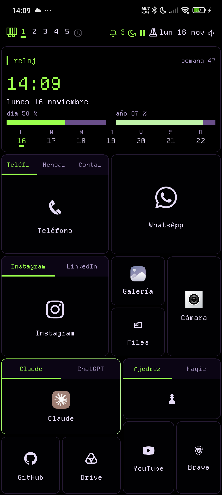</a> | <a href="docs/screenshots/menu-current-redmi.png">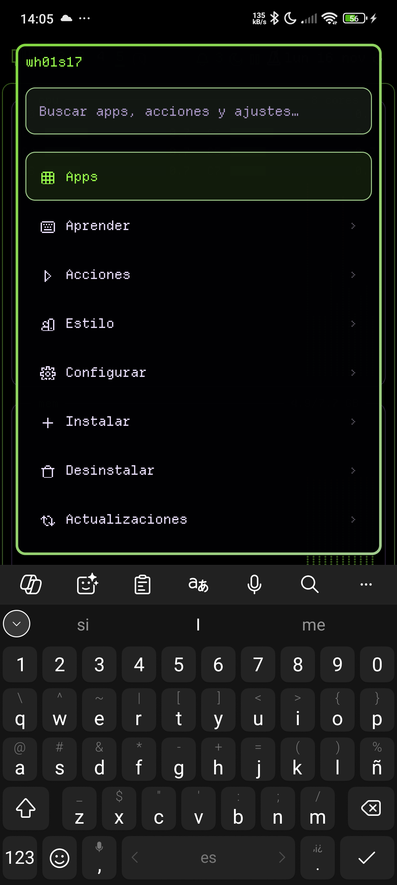</a> | <a href="docs/screenshots/edit-redmi.png">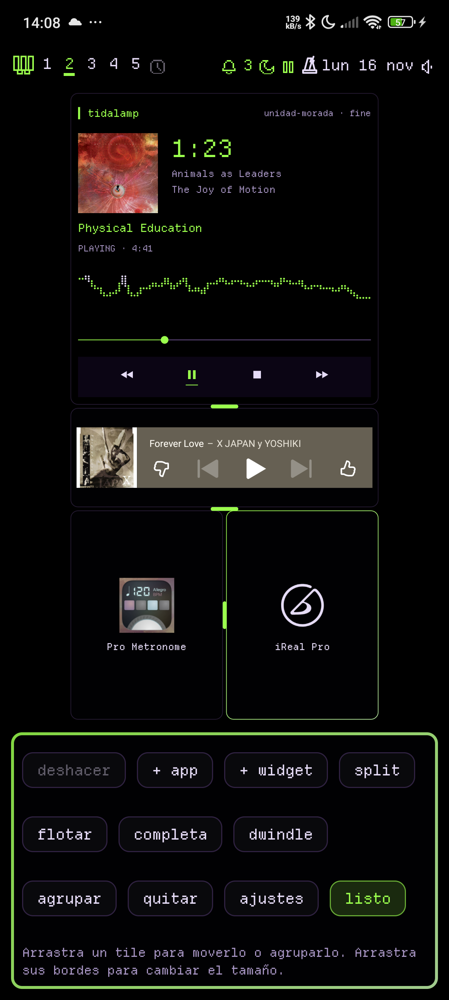</a> |

| Opciones de Estilo | Paletas | Temáticas de widgets |
| --- | --- | --- |
| <a href="docs/screenshots/style-redmi.png">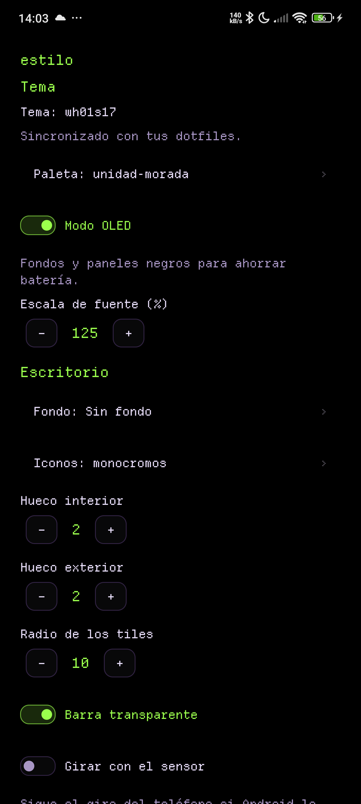</a> | <a href="docs/screenshots/palettes-redmi.png">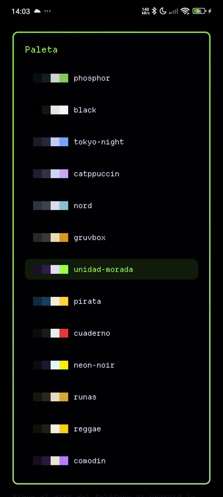</a> | <a href="docs/screenshots/widget-themes-redmi.png">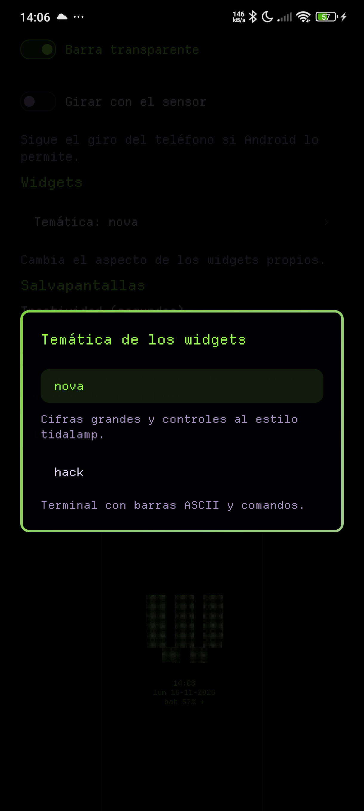</a> |

[Más opciones de Estilo](docs/screenshots/style-widgets-redmi.png) · [Salvapantallas](docs/screenshots/style-screensaver-redmi.png) · [Configuración](docs/screenshots/style-config-redmi.png) · [Selector de widgets](docs/screenshots/widget-picker-redmi.png) · [Menú Estilo](docs/screenshots/style-menu-redmi.png)

### Widgets propios

| Widget | nova | hack |
| --- | --- | --- |
| Reloj |  | <a href="docs/screenshots/widgets-hack-clock-redmi.png">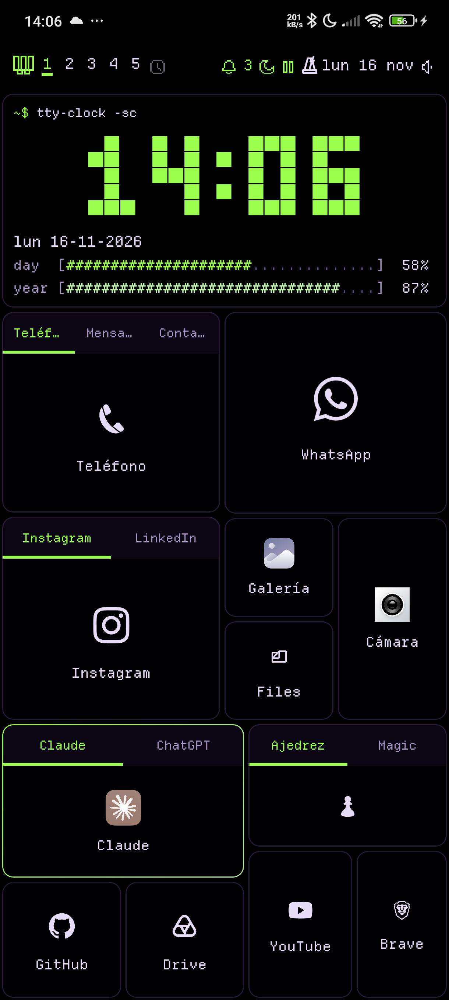</a> |
| Pomodoro y metrónomo | <a href="docs/screenshots/workspace-4-redmi.png">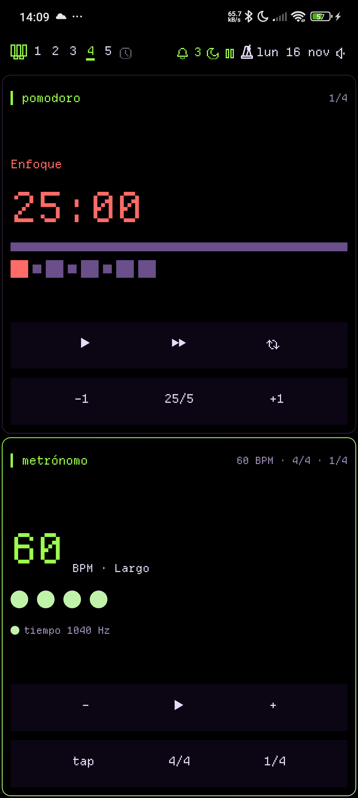</a> | <a href="docs/screenshots/widgets-hack-timers-redmi.png">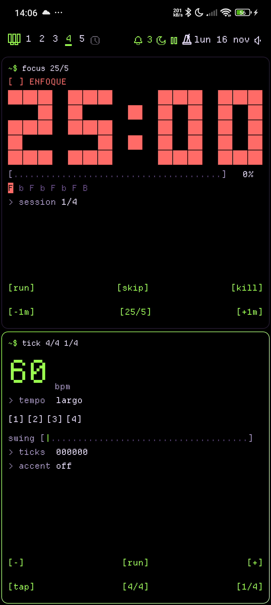</a> |
| Sistema | <a href="docs/screenshots/workspace-5-redmi.png">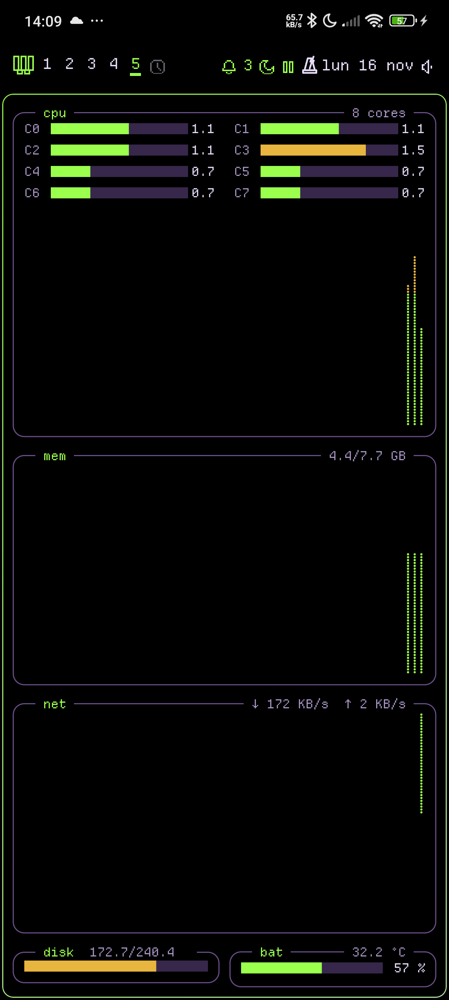</a> | <a href="docs/screenshots/widgets-hack-system-redmi.png">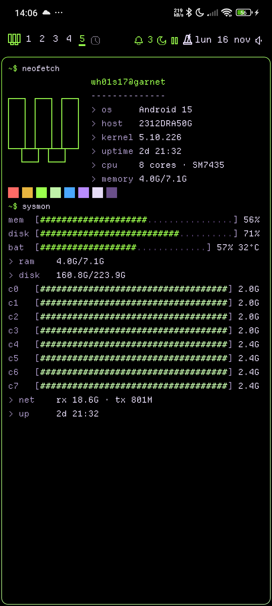</a> |

### TIDAL: todos los visualizadores

Capturados mientras sonaba música en el Redmi. Cada visualizador se cambia tocando su gráfico.

| nova | hack |
| --- | --- |
| **fine** <a href="docs/screenshots/tidal-nova-fine-redmi.png">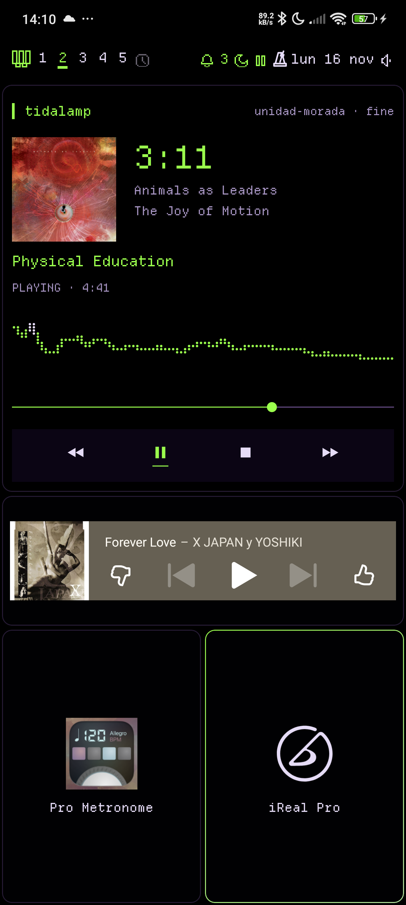</a> | **blocks** <a href="docs/screenshots/tidal-hack-blocks-redmi.png">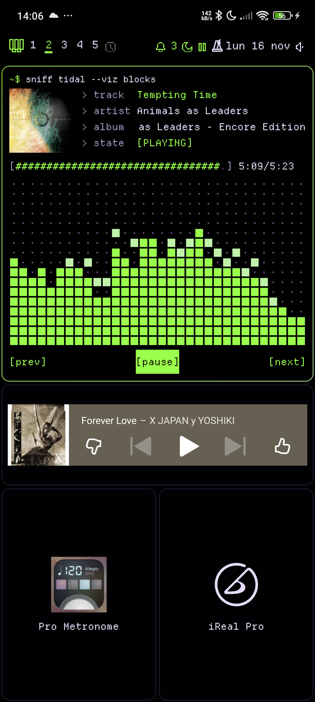</a> |
| **bars** <a href="docs/screenshots/tidal-nova-bars-redmi.png">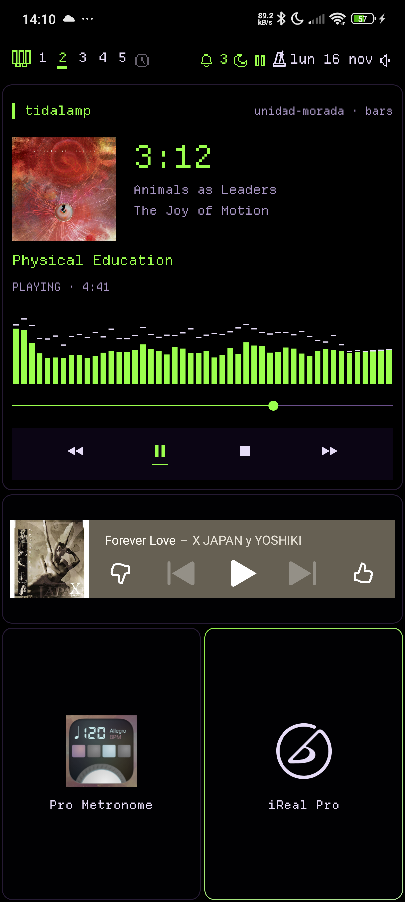</a> | **cava** <a href="docs/screenshots/tidal-hack-cava-redmi.png">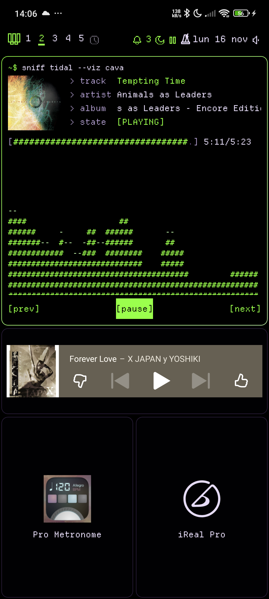</a> |
| **mirror** <a href="docs/screenshots/tidal-nova-mirror-redmi.png">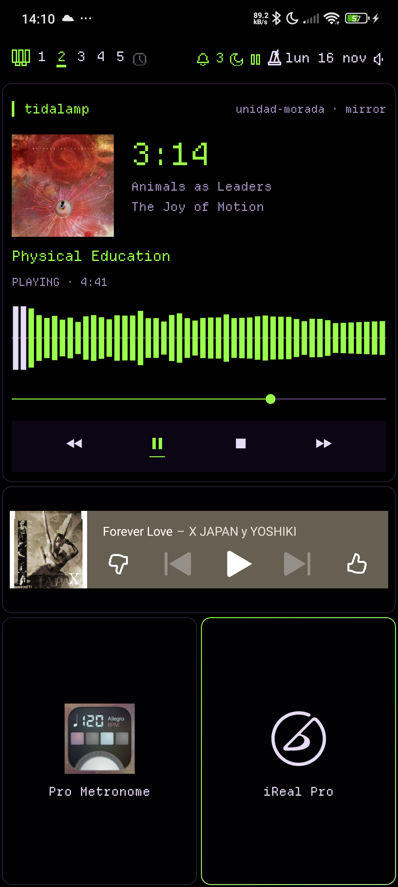</a> | **scope** <a href="docs/screenshots/tidal-hack-scope-redmi.png">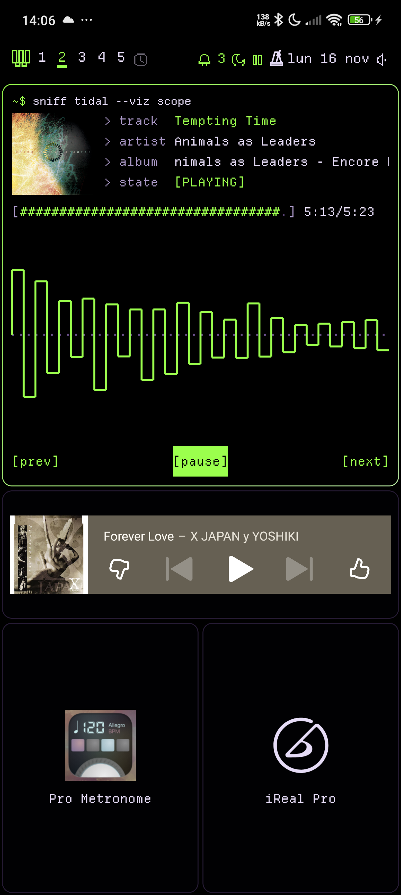</a> |
| **curve**  | **hexdump** <a href="docs/screenshots/tidal-hack-hexdump-redmi.png">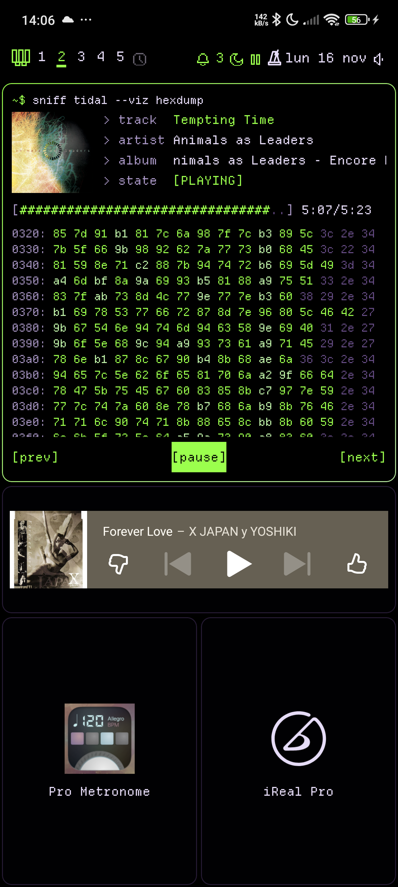</a> |

[Historial de cambios](CHANGELOG.md).

Documentación:

- [Guía de uso](docs/usage.md).
- [Preparar el entorno y compilar](docs/setup.md).
- [Usar y editar los escritorios](docs/workspaces.md).
- [Configurar la barra](docs/bar.md).
- [Menú wh01s17](docs/menu.md).
- [Atajos de teclado y gestos](docs/bindings.md).
- [Sistema de diseño](docs/design-system.md).
- [Gestos en Xiaomi, pruebas y recuperación](docs/xiaomi.md).
- [Estilo y fondos](docs/style.md), [notificaciones y media](docs/notifications.md) y
  [salvapantallas](docs/screensaver.md).
- [Rendimiento](docs/performance.md), [accesibilidad](docs/accessibility.md),
  [publicar una versión](docs/release.md) y [pruebas manuales](docs/manual-qa.md).

Licencia: [MIT](LICENSE).
