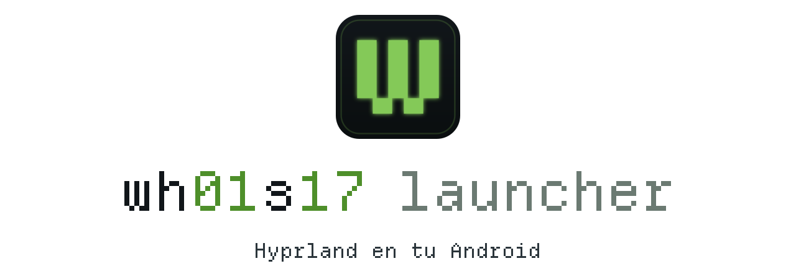
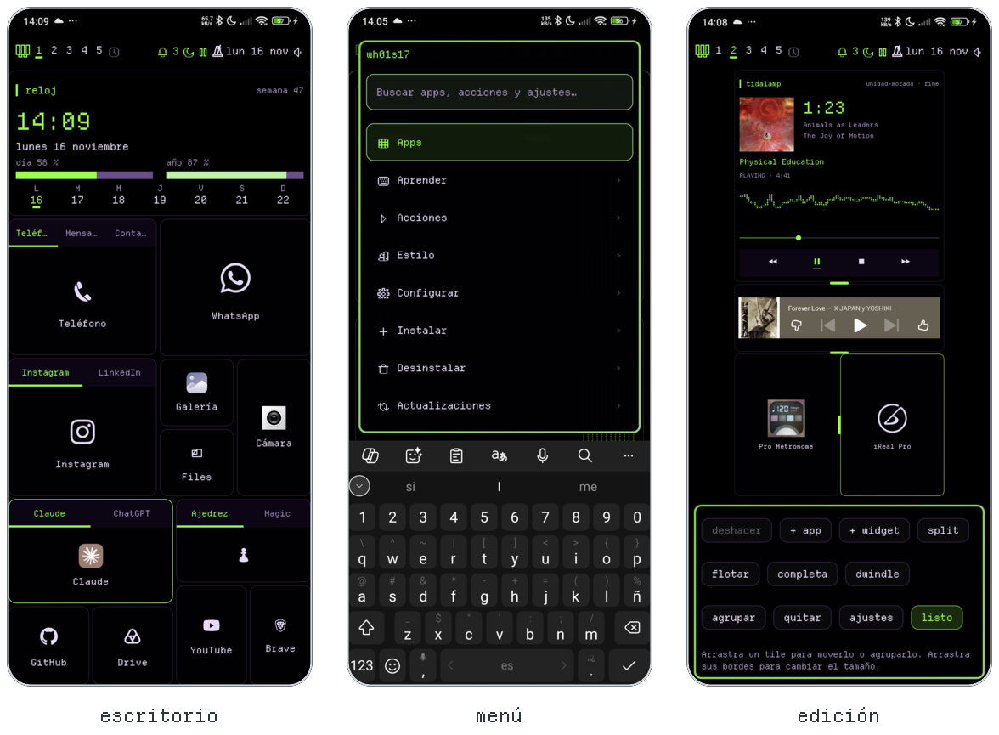
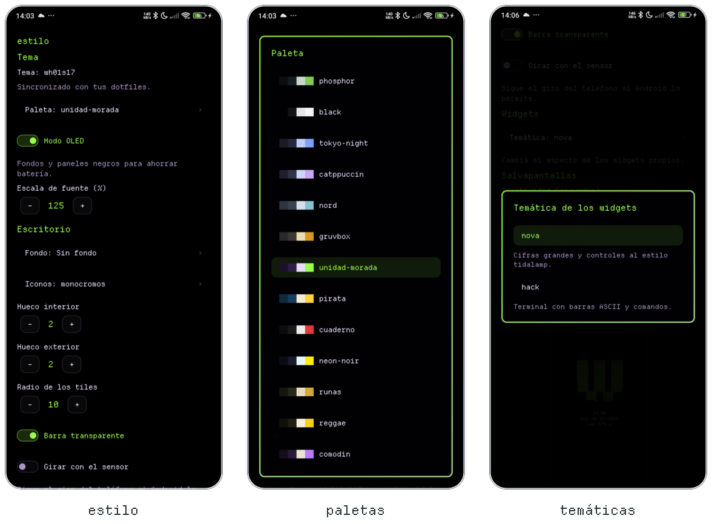
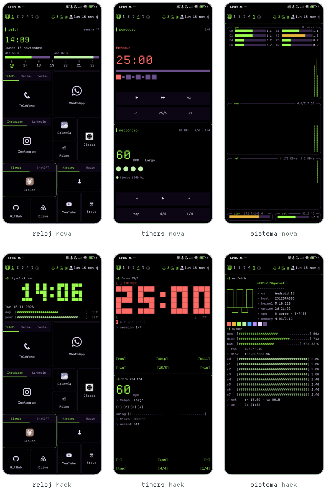
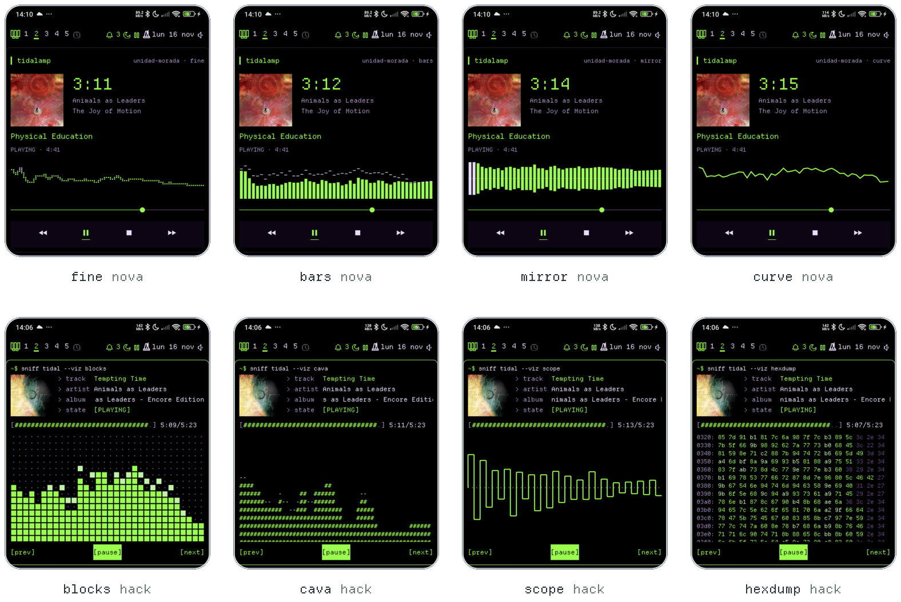

<p align="center">
  <picture>
    <source media="(prefers-color-scheme: dark)" srcset="docs/readme/banner-dark.png">
    
  </picture>
</p>

<p align="center">
  <a href="https://github.com/wh01s17/android-launcher/releases"></a>
  
  
  <a href="LICENSE"></a>
</p>

<p align="center">
  Launcher para Android que recrea el uso de Hyprland (workspaces, tiling, barra modular, menú y
  atajos) con el tema <code>wh01s17</code> de <a href="https://github.com/wh01s17/dotfiles">dotfiles</a>.
</p>

<p align="center">
  <a href="https://github.com/wh01s17/android-launcher/releases"><b>Descargar APK</b></a> ·
  <a href="docs/usage.md"><b>Guía de uso</b></a> ·
  <a href="docs/setup.md"><b>Compilar</b></a> ·
  <a href="CHANGELOG.md"><b>Cambios</b></a>
</p>

<p align="center">
  <picture>
    <source media="(prefers-color-scheme: dark)" srcset="docs/readme/overview-dark.png">
    
  </picture>
</p>

## Qué incluye

- **Escritorios:** diez, con tiles en mosaico (dwindle y master), edición, grupos y scratchpad. Los
  tiles abren las apps; no las incrustan en el escritorio.
- **Barra modular** y **menú wh01s17** con búsqueda difusa de apps, comandos, ajustes y atajos.
- **Atajos de teclado y gestos** configurables como en `bindings.lua` (`ALT` hace de `SUPER`).
- **Widgets** del sistema y propios: TIDAL, pomodoro, metrónomo, reloj y uso del sistema.
- **Notificaciones y media.**
- **Estilo:** 16 paletas, fondos y la W girando como salvapantallas.
- **Navegación propia para HyperOS.**

Los hitos 0–8, 10 y 11 están terminados (el 9, ventanas libres, se descartó). El avance está en
[`plan.md` §12](plan.md#12-estado-actual). Probado en Redmi Note 13 Pro 5G con HyperOS 2.0.204
(Android 15).

## Instalar

El APK firmado se publica en [Releases](https://github.com/wh01s17/android-launcher/releases)
([cómo se publica](docs/release.md)). Para el uso diario desde el código:

```sh
./gradlew installFast
```

## Capturas

Capturas reales del Redmi. Las originales a tamaño completo están en
[`docs/screenshots/`](docs/screenshots).

### Estilo

<p align="center">
  <picture>
    <source media="(prefers-color-scheme: dark)" srcset="docs/readme/style-dark.png">
    
  </picture>
</p>

Más pantallas: [opciones de Estilo](docs/screenshots/style-widgets-redmi.png) ·
[salvapantallas](docs/screenshots/style-screensaver-redmi.png) ·
[configuración](docs/screenshots/style-config-redmi.png) ·
[selector de widgets](docs/screenshots/widget-picker-redmi.png) ·
[menú Estilo](docs/screenshots/style-menu-redmi.png).

### Widgets propios

Cada widget tiene dos temáticas: `nova` y `hack`.

<p align="center">
  <picture>
    <source media="(prefers-color-scheme: dark)" srcset="docs/readme/widgets-dark.png">
    
  </picture>
</p>

### TIDAL: todos los visualizadores

Capturados mientras sonaba música. Cada visualizador se cambia tocando su gráfico.

<p align="center">
  <picture>
    <source media="(prefers-color-scheme: dark)" srcset="docs/readme/tidal-dark.png">
    
  </picture>
</p>

## Documentación

| Tema | Guías |
| --- | --- |
| Empezar | [Guía de uso](docs/usage.md) · [Preparar el entorno y compilar](docs/setup.md) |
| Escritorio | [Escritorios](docs/workspaces.md) · [Barra](docs/bar.md) · [Menú wh01s17](docs/menu.md) · [Atajos y gestos](docs/bindings.md) |
| Apariencia | [Estilo y fondos](docs/style.md) · [Salvapantallas](docs/screensaver.md) · [Sistema de diseño](docs/design-system.md) |
| Sistema | [Notificaciones y media](docs/notifications.md) · [Gestos en Xiaomi, pruebas y recuperación](docs/xiaomi.md) |
| Calidad | [Rendimiento](docs/performance.md) · [Accesibilidad](docs/accessibility.md) · [Pruebas manuales](docs/manual-qa.md) · [Publicar una versión](docs/release.md) |

Las imágenes de este README se generan con `tools/readme-images.sh` a partir del logo y de las
capturas de `docs/screenshots/`; vuelve a ejecutarlo tras recapturar.

## Licencia

[MIT](LICENSE).
